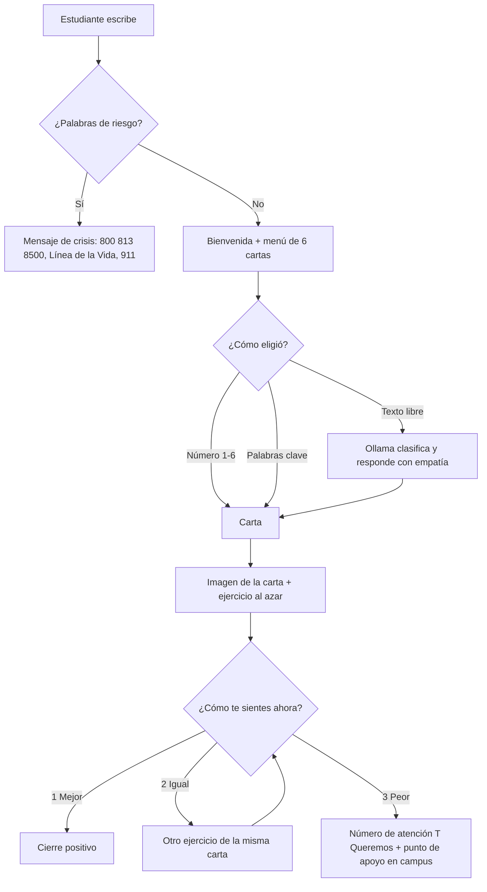

# Chatbot — Botiquín para la calma

Servicio becario. Chatbot de WhatsApp para el **Botiquín para la calma** de LiFE Bienestar Estudiantil.
El estudiante dice cómo se siente y el bot le manda un ejercicio de una de las 6 cartas del botiquín.
La IA corre **local con Ollama** (sin costo por mensaje y los datos no salen del servidor).

> Prototipo con una **conversación estándar**. El guion final lo está escribiendo otro equipo:
> sus textos van en [`src/mensajes.js`](src/mensajes.js), sin tocar la lógica.

## Cómo funciona la conversación



Comandos en cualquier momento: `menú`, `otro`, `hola`, `adiós`.

### Las 6 cartas (5 ejercicios cada una)

| # | Carta | Ejemplos de ejercicios |
|---|---|---|
| 1 | Estoy estresado/a | 5-4-3-2-1 con los sentidos, respiración 4-7-8, relajación muscular, box breathing |
| 2 | Me siento ansioso/a | Movimiento breve, enraizamiento, anclaje al presente, reencuadre, TIP |
| 3 | Hoy me siento triste | Defusión cognitiva, contacto con valores, gratitud, opuesto a la emoción, autocuidado |
| 4 | No he dormido bien | Técnica para la noche, plan para sobrevivir el día, higiene de sueño, mini reset |
| 5 | Necesito una pausa | Una canción, pausa guiada exprés, microdescanso, habilidad STOP |
| 6 | Me siento solo/a | Contacto con valores, conexión simbólica, opuesto a la emoción, autocompasión |

El contenido completo está en [`src/botiquin.js`](src/botiquin.js).

### Ejemplo de conversación

```
Estudiante: hola
Bot:        ¡Hola! 👋 Soy el asistente del Botiquín para la calma...
Bot:        ¿Cómo te sientes hoy? 1️⃣ Estoy estresado/a ... 6️⃣ Me siento solo/a
Estudiante: mañana tengo examen y no puedo concentrarme
Bot:        (IA) Es normal sentir esa presión antes de un examen.
Bot:        [imagen carta "Estoy estresado/a"] Gracias por contarme...
Bot:        *Ejercicio de respiración box breathing* ...
Bot:        ¿Cómo te sientes ahora? 1️⃣ Mejor 2️⃣ Igual 3️⃣ Peor
Estudiante: 1
Bot:        ¡Qué bueno! 🙌 Recuerda que puedes volver al botiquín cuando lo necesites.
```

## Instalación

Requisitos: [Node.js 18+](https://nodejs.org) y [Ollama](https://ollama.com/download).

```bash
git clone https://github.com/Kingsouls811/chatbot.git
cd chatbot
npm install
ollama pull llama3.2:3b
cp .env.example .env   # en Windows: copy .env.example .env
```

### Notas para Windows

- Instala con `$env:PUPPETEER_SKIP_DOWNLOAD="true"; npm.cmd install`. El bot usa el Edge o Chrome del sistema, así que no hace falta que puppeteer descargue su propio Chrome (esa descarga suele fallar).
- En PowerShell usa `npm.cmd` en vez de `npm` si aparece el error de "ejecución de scripts deshabilitada".
- No corras el bot en dos computadoras a la vez con el mismo número: cada mensaje se contestaría dos veces.
- Con menos de 8 GB de RAM la IA va lenta: pon `OLLAMA_ACTIVO=false` en `.env` y el bot funciona solo con menú y palabras clave.

### Probar sin WhatsApp (consola)

```bash
npm run consola
```

### Conectar a WhatsApp

```bash
npm start
```

Aparece un código QR en la terminal. En el celular del bot: **WhatsApp → Dispositivos vinculados → Vincular dispositivo** y escanéalo.
Si el QR de la terminal sale deformado, el bot también lo abre en el navegador (`qr.html`, se actualiza sola).
Otra opción sin QR: pon `NUMERO_BOT` en `.env` y el bot muestra un código de 8 letras para **"Vincular con el número de teléfono"**.
La sesión se guarda en `~/.botiquin-bot` (en Windows: `C:\Users\<tu usuario>\.botiquin-bot`), así que solo se escanea la primera vez.

El bot usa el Chrome o Edge que ya tengas instalado. Si `npm install` avisa que puppeteer no pudo descargar su Chrome, no pasa nada.

> ⚠️ `whatsapp-web.js` no es la API oficial de WhatsApp. Para el prototipo usa un número de prueba.
> La versión final debería migrar a la WhatsApp Business Cloud API de Meta.

## Configuración (`.env`)

| Variable | Default | Para qué |
|---|---|---|
| `OLLAMA_ACTIVO` | `true` | `false` = el bot funciona solo con menú y palabras clave |
| `OLLAMA_URL` | `http://localhost:11434` | Dónde corre Ollama |
| `OLLAMA_MODEL` | `llama3.2:3b` | Modelo. Con GPU se puede usar `llama3.1:8b` o `qwen2.5:7b` |
| `OLLAMA_TIMEOUT_MS` | `30000` | Si la IA tarda más, el bot muestra el menú |
| `CHROME_PATH` | se busca solo | Navegador para WhatsApp Web (Chrome o Edge) |
| `NUMERO_BOT` | vacío | Número del bot (521 + 10 dígitos) para vincular con código en vez de QR |
| `SESION_PATH` | `~/.botiquin-bot` | Carpeta de la sesión de WhatsApp. Debe ser una ruta **corta** en Windows |

Si Ollama no está corriendo, el bot **no se cae**: sigue funcionando con el menú.
Al arrancar, el bot carga el modelo en memoria para que el primer mensaje no tarde; ya cargado, `llama3.2:3b` contesta en 1–3 s en una laptop con 16 GB de RAM y sin GPU.

## Correrlo en un servidor (Tec)

`whatsapp-web.js` solo hace conexiones de salida, así que no hace falta abrir puertos ni IP pública.

```bash
npm install -g pm2
pm2 start src/whatsapp.js --name botiquin
pm2 save
pm2 startup
```

## Estructura

```
src/
  mensajes.js      ← GUION: todos los textos del bot (lo edita el equipo de guion)
  botiquin.js      ← contenido de las 6 cartas y sus ejercicios
  conversacion.js  ← lógica del flujo (estados, menú, seguimiento, crisis)
  ollama.js        ← conexión con la IA local
  whatsapp.js      ← conexión con WhatsApp
  consola.js       ← modo de prueba en terminal
assets/cartas/     ← imágenes de las cartas
```

## Aviso

Este bot ofrece ejercicios de bienestar y **no sustituye la atención psicológica profesional**.
Si detecta palabras de riesgo, comparte de inmediato el número de atención T Queremos (800 813 8500),
la Línea de la Vida (800 911 2000) y el 911.
